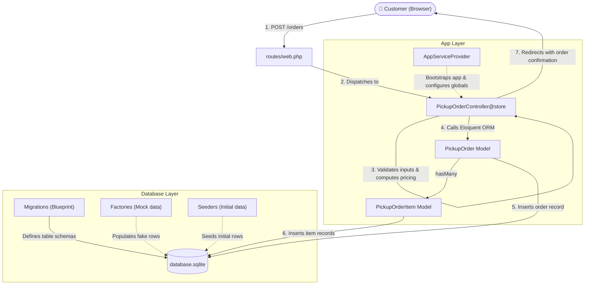

# Laravel Architecture Guide: How It Works in Whisk & Brew

Welcome! This guide explains the core architectural building blocks of Laravel — **Controllers**, **Models**, **Providers**, **Migrations**, **Factories**, and **Seeders** — specifically tailored to how they work in **Whisk & Brew**.

---

## ☕ The Whisk & Brew Café Analogy

To make these concepts intuitive, imagine our application as a physical specialty matcha & coffee café:

| Laravel Component | Café Role | Real-Life Responsibility |
| :--- | :--- | :--- |
| **Migration** | **Kitchen Blueprint & Carpentry** | Builds the physical shelves, counters, and storage bins where items will live. |
| **Model** | **The Official Order Slip / Menu Item** | Defines what an order contains, its rules, and how it links to individual items on the ticket. |
| **Controller** | **The Cashier / Counter Barista** | Greets the customer, validates their order, takes the payment, writes up the ticket, and hands back the receipt. |
| **Provider** | **The Café Manager / Utilities Setup** | Turns on electricity, calibrates espresso machines, and sets global rules before the café opens its doors. |
| **Factory** | **Sample Order Generator** | Creates fake dummy orders with random customer names and drinks to test barista speed and training. |
| **Seeder** | **Grand Opening Stocker** | Stocks the café shelves with initial goods (e.g. the default catalog or test records) so the shop is ready on day one. |

---

## 🔄 The Big Picture: How Everything Connects

Here is how an incoming HTTP request flows through these components:



---

## 1. Migrations: The Database Blueprint

### What is a Migration?
A migration is **version control for your database**. Instead of opening a database GUI and manually clicking to add tables and columns, you define them in PHP code. This ensures everyone on your team (and your production server) has the exact same database structure.

### Anatomy of a Migration:
Every migration has two primary methods:
- **`up()`**: Defines what tables or columns to create/modify when you run `php artisan migrate`.
- **`down()`**: Defines how to reverse (rollback) those exact changes when you run `php artisan migrate:rollback`.

### Whisk & Brew Example
In our project, we need two tables: `pickup_orders` and `pickup_order_items`.

```php
// database/migrations/xxxx_create_pickup_orders_tables.php
use Illuminate\Database\Migrations\Migration;
use Illuminate\Database\Schema\Blueprint;
use Illuminate\Support\Facades\Schema;

return new class extends Migration
{
    public function up(): void
    {
        // 1. Parent table: Orders
        Schema::create('pickup_orders', function (Blueprint $table) {
            $table->id();
            $table->uuid('reference')->unique();        // Unique order reference (UUID)
            $table->string('customer_name', 120);       // Customer name
            $table->string('email');                    // Customer email
            $table->unsignedSmallInteger('pickup_in_minutes'); // 10, 20, 30, 45
            $table->unsignedInteger('subtotal');        // Subtotal in PHP cents/pesos
            $table->char('currency', 3)->default('PHP');
            $table->string('status', 32)->default('pending');
            $table->timestamps();                       // created_at and updated_at
        });

        // 2. Child table: Individual items within an order
        Schema::create('pickup_order_items', function (Blueprint $table) {
            $table->id();
            $table->foreignId('pickup_order_id')
                ->constrained('pickup_orders')
                ->cascadeOnDelete();                    // Deleting the order deletes its items
            $table->unsignedBigInteger('menu_item_id');
            $table->string('item_name');
            $table->unsignedSmallInteger('quantity');
            $table->unsignedInteger('unit_price');
            $table->unsignedInteger('line_total');
            $table->json('customization')->nullable();  // e.g. {"temperature":"Iced","milk":"Barista Oat Milk"}
            $table->timestamps();
        });
    }

    public function down(): void
    {
        // Drop child first to respect foreign key constraints
        Schema::dropIfExists('pickup_order_items');
        Schema::dropIfExists('pickup_orders');
    }
};
```

### Essential Migration Commands:
- `php artisan make:migration create_pickup_orders_tables` — Generate a new migration file.
- `php artisan migrate` — Run all pending migrations.
- `php artisan migrate:status` — Check which migrations have run and which are pending.
- `php artisan migrate:rollback` — Revert the last batch of migrations.
- `php artisan migrate:fresh` — Drop all tables and re-run all migrations from scratch.

---

## 2. Models: The Eloquent Data Objects

### What is a Model?
In Laravel, a Model represents a **single table in your database** through Eloquent (Laravel's Object-Relational Mapper or ORM). 

Instead of writing raw SQL like:
```sql
SELECT * FROM pickup_orders WHERE id = 1;
```
You write expressive PHP:
```php
$order = PickupOrder::find(1);
```

### Key Responsibilities of a Model:
1. **Mass Assignment Protection (`$fillable`)**: Declares which columns can be safely saved using `create()` or `update()`, preventing users from injecting unwanted fields.
2. **Type Casting (`$casts` or `casts()`)**: Converts raw database values to PHP types automatically (for example, turning a raw database JSON string into a PHP array).
3. **Relationships**: Links tables together (`hasMany`, `belongsTo`, `hasOne`, `belongsToMany`).

### Whisk & Brew Example

#### Order Model: `app/Models/PickupOrder.php`
```php
namespace App\Models;

use Illuminate\Database\Eloquent\Model;
use Illuminate\Database\Eloquent\Relations\HasMany;

class PickupOrder extends Model
{
    // Allowed fields for mass assignment
    protected $fillable = [
        'reference',
        'customer_name',
        'email',
        'pickup_in_minutes',
        'subtotal',
        'currency',
        'status',
    ];

    // An order has many order items
    public function items(): HasMany
    {
        return $this->hasMany(PickupOrderItem::class);
    }
}
```

#### Order Item Model: `app/Models/PickupOrderItem.php`
```php
namespace App\Models;

use Illuminate\Database\Eloquent\Model;
use Illuminate\Database\Eloquent\Relations\BelongsTo;

class PickupOrderItem extends Model
{
    protected $fillable = [
        'menu_item_id',
        'item_name',
        'quantity',
        'unit_price',
        'line_total',
        'customization',
    ];

    // Automatically cast the customization JSON column to a PHP array
    protected function casts(): array
    {
        return [
            'customization' => 'array',
        ];
    }

    // Each item belongs to one pickup order
    public function order(): BelongsTo
    {
        return $this->belongsTo(PickupOrder::class, 'pickup_order_id');
    }
}
```

### Essential Model Commands:
- `php artisan make:model PickupOrder` — Create a new model.
- `php artisan make:model PickupOrder -m` — Create a model **and** its migration at the same time!

---

## 3. Controllers: The Traffic Coordinator

### What is a Controller?
The Controller sits between your routes and your data. It does not store data itself; instead, it coordinates actions:
1. Receives an incoming HTTP request (e.g. from the React menu page).
2. Validates incoming form parameters (e.g. valid email, positive quantity, valid toppings).
3. Executes business logic (calculates prices, validates milk customizations).
4. Persists the record using Models inside a database transaction (`DB::transaction`).
5. Returns a response (e.g. redirects back with session flash data or renders an Inertia view).

### Whisk & Brew Example: `PickupOrderController.php`
Inspect [PickupOrderController.php](file:///C:/TrainAi/Whisk_Brew/app/Http/Controllers/PickupOrderController.php#L16-L132) to see how it uses our models:

```php
public function store(Request $request): RedirectResponse
{
    // 1. Validate incoming request
    $validated = $request->validate([...]);

    // 2. Compute server-authoritative totals
    // ...

    // 3. Save to database using Eloquent models
    $order = DB::transaction(function () use ($validated, $lines, $subtotal): PickupOrder {
        $order = PickupOrder::create([
            'reference' => (string) Str::uuid(),
            'customer_name' => $validated['customer_name'],
            'email' => $validated['email'],
            'pickup_in_minutes' => $validated['pickup_in_minutes'],
            'subtotal' => $subtotal,
            'currency' => 'PHP',
            'status' => 'pending',
        ]);

        // Save related items through the relationship method
        $order->items()->createMany($lines);

        return $order;
    });

    // 4. Redirect with confirmation
    return redirect()
        ->route('menu')
        ->with('order_confirmation', [
            'reference' => $order->reference,
            'total' => $order->subtotal,
        ]);
}
```

---

## 4. Providers: The Application Bootstrapper

### What is a Service Provider?
Service Providers are the central place where Laravel applications are configured, bootstrapped, and bound together. Before any controller handles a request, Laravel boots all registered service providers.

### The Two Lifecycle Methods:
- **`register()`**: Used strictly to bind classes, singletons, or interfaces into Laravel's Service Container. You should **never** register event listeners or routes here, because other services might not be ready yet.
- **`boot()`**: Called after **all** service providers have registered. Here you can configure packages, register view composers, define gate permissions, or set global options.

### Whisk & Brew Example: `AppServiceProvider.php`
In [AppServiceProvider.php](file:///C:/TrainAi/Whisk_Brew/app/Providers/AppServiceProvider.php#L21-L24):
```php
namespace App\Providers;

use Illuminate\Support\Facades\Vite;
use Illuminate\Support\ServiceProvider;

class AppServiceProvider extends ServiceProvider
{
    public function register(): void
    {
        // Bind custom services if needed
    }

    public function boot(): void
    {
        // Configures asset prefetching for the Vite frontend
        Vite::prefetch(concurrency: 3);
    }
}
```

Providers are registered in [bootstrap/providers.php](file:///C:/TrainAi/Whisk_Brew/bootstrap/providers.php).

---

## 5. Factories: Realistic Fake Data on Demand

### What is a Factory?
A Factory is a recipe for generating fake, realistic records for testing or development using the **Faker** library. Instead of manually writing dummy names, emails, and phone numbers in your tests, a factory generates them automatically.

### Whisk & Brew Example: `database/factories/PickupOrderFactory.php`
```php
namespace Database\Factories;

use App\Models\PickupOrder;
use Illuminate\Database\Eloquent\Factories\Factory;
use Illuminate\Support\Str;

class PickupOrderFactory extends Factory
{
    protected $model = PickupOrder::class;

    public function definition(): array
    {
        return [
            'reference' => (string) Str::uuid(),
            'customer_name' => fake()->name(),
            'email' => fake()->safeEmail(),
            'pickup_in_minutes' => fake()->randomElement([10, 20, 30, 45]),
            'subtotal' => fake()->numberBetween(150, 800),
            'currency' => 'PHP',
            'status' => 'pending',
        ];
    }
}
```

### How You Use Factories in Code:
```php
// Create 1 fake order in the database
$order = PickupOrder::factory()->create();

// Create 10 fake orders
$orders = PickupOrder::factory()->count(10)->create();

// Create an in-memory order (not saved to database)
$order = PickupOrder::factory()->make();
```

---

## 6. Seeders: Populating Your Database

### What is a Seeder?
A Seeder is a class designed to populate your database with dummy records, initial configurations, or default admin accounts. 

While migrations build the **structure** (the tables), seeders insert the **content** (the rows).

### Whisk & Brew Example: `database/seeders/DatabaseSeeder.php`
```php
namespace Database\Seeders;

use Illuminate\Database\Seeder;
use App\Models\PickupOrder;
use App\Models\PickupOrderItem;

class DatabaseSeeder extends Seeder
{
    public function run(): void
    {
        // Populate 5 orders with items for local development testing
        PickupOrder::factory()
            ->count(5)
            ->create()
            ->each(function (PickupOrder $order) {
                PickupOrderItem::factory()->count(2)->create([
                    'pickup_order_id' => $order->id,
                ]);
            });
    }
}
```

### Essential Seeder Commands:
- `php artisan make:seeder PickupOrderSeeder` — Create a new seeder.
- `php artisan db:seed` — Run the root `DatabaseSeeder`.
- `php artisan migrate:fresh --seed` — Drop all tables, re-run all migrations, and immediately seed the database!

---

## 🛠️ Step-by-Step: Rebuilding Your Database Layer

Now that you understand the concepts, here is your roadmap to write the code yourself:

### Step 1: Create the Migration
Run the following artisan command in your terminal:
```bash
php artisan make:migration create_pickup_orders_tables
```
Open the new migration in `database/migrations/` and define the `pickup_orders` and `pickup_order_items` tables using the schema shown in [Section 1](#1-migrations-the-database-blueprint).

### Step 2: Run the Migration
```bash
php artisan migrate
```
Verify the tables were created:
```bash
php artisan db:show
```

### Step 3: Create the Models
Generate the two models:
```bash
php artisan make:model PickupOrder
php artisan make:model PickupOrderItem
```
Open each file in `app/Models/` and add:
- The `$fillable` array.
- The `casts()` method (on `PickupOrderItem` for `customization => array`).
- The relationship methods (`items()` on `PickupOrder`, `order()` on `PickupOrderItem`).

### Step 4: Verify with the Test Suite
Run the test suite to verify your implementation:
```bash
php artisan test --filter=PickupOrderTest
```
When all assertions pass, your database layer is 100% operational and connected!

---

## 📋 Quick Reference Summary

| Concept | File Location | Artisan Generator | Purpose |
| :--- | :--- | :--- | :--- |
| **Migration** | `database/migrations/` | `php artisan make:migration ...` | Schema definition & version control |
| **Model** | `app/Models/` | `php artisan make:model ...` | Eloquent ORM table representation |
| **Controller** | `app/Http/Controllers/` | `php artisan make:controller ...` | Handles requests, validation, & responses |
| **Provider** | `app/Providers/` | `php artisan make:provider ...` | Bootstraps configuration & bindings |
| **Factory** | `database/factories/` | `php artisan make:factory ...` | Defines blueprint for mock data generation |
| **Seeder** | `database/seeders/` | `php artisan make:seeder ...` | Inserts default or test records into the DB |
